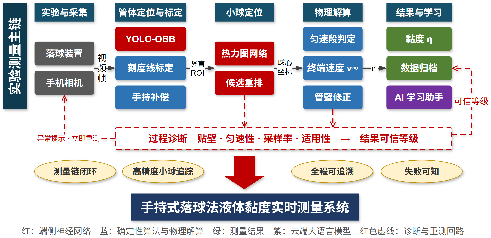
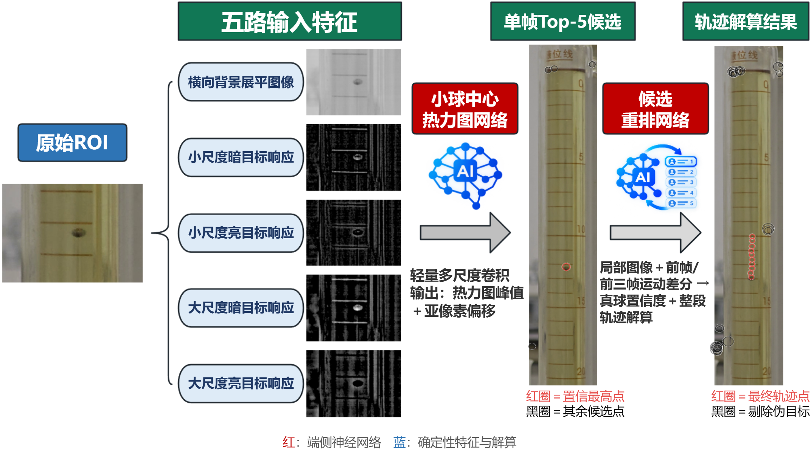

# FallingBallTube / 落球管追踪

面向落球法实验的 Android 应用：通过相机实时测量或导入本机视频，识别试管与刻度、
追踪小球、拟合终端速度，并在实验参数完整时计算动力黏度。测量结果保存在本机，
支持曲线查看、参数重算和 CSV 导出，也可使用可选的 AI 学习助手解释实验数据。

[系统概览](#系统概览) · [打开与运行](#打开与运行) · [落球测速](#落球测速) ·
[视频分析](#导入视频分析) · [模型与加速](#模型与加速) · [工程结构](#工程结构)

## 系统概览

[](docs/images/system-overview.png)

*图 1 · 测量流程与诊断反馈示意。* 从视频采集、管体定位与标定、小球追踪到终端速度和黏度计算，
串联结果归档与 AI 学习助手；红色虚线表示过程诊断、异常提示和重测反馈。点击图片可查看原图。

## 功能

- 后置相机实时预览，自动识别管体、刻度线和小球，支持倾斜管体与手持时的时序配准。
- 自动/手动对焦、设备支持的镜头与变焦控制；可切换 720p / 1080p 分析分辨率和 320 / 416 / 512 / 640 档 YOLO 输入。
- 提供手机水平指示器，并在设备支持时开启光学或电子防抖。
- 自动确认小球连续向下运动，追踪结束后解算完整轨迹，估计稳定段终端速度。
- 结合球径、管内径和二维球心检测持续贴壁，保留异常与低采样率提示。
- 参数完整时计算动力黏度，提供 Faxén / Haberman-Sayre 管壁修正和一阶 Oseen 结果。
- 导入本机原速 SDR 视频，按原始时间戳逐帧分析；支持后台进度、取消和结果保存。
- 本机保存测量记录，支持位移—时间图、逐帧数据、参数重算、删除和 CSV 导出。
- 可选 AI 学习助手结合测量记录与知识资料提供数据讲解和学习引导。

## 环境要求

| 项目 | 当前配置 |
| --- | --- |
| Android Studio | 支持 Android Gradle Plugin 8.7.2 的版本 |
| JDK / Gradle | JDK 17；仓库提供 Gradle 8.9 Wrapper |
| Android SDK | Platform 35；`compileSdk` / `targetSdk` 为 35，`minSdk` 为 26 |
| 原生构建 | NDK `27.0.12077973`、CMake `3.22.1`、C++17 |
| QNN SDK | Qualcomm QAIRT / QNN SDK 2.50，通过 `QNN_SDK_ROOT` 指定完整 SDK 根目录 |
| 设备 | Android 8.0+；仅打包 `arm64-v8a`，相机测量使用 ARM64 真机 |

在 Android Studio 的 SDK Manager 中安装 SDK Platform 35，并在 SDK Tools 的
“Show Package Details”中选择上述 NDK 和 CMake 版本。真机调试需要开启 USB 调试。

QNN 头文件和 `libQnn*.so` 由构建者自行准备，不随源码仓库分发。完整 QAIRT SDK 2.50
需要包含 `include/QNN/QnnInterface.h`、Android ARM64 与 Hexagon v75 运行库，
以及 SDK 原始 `LICENSE.pdf`、`NOTICE.txt` 等许可材料。
在启动 Android Studio 或命令行构建前设置环境变量，例如：

```powershell
$env:QNN_SDK_ROOT = '<QAIRT SDK 目录>'
```

构建会读取 SDK 头文件，将所需 QNN 运行库与许可材料复制到构建输出后打包进 APK。
NCNN 头文件和 ARM64 `libncnn.so` 已包含在仓库中。即使目标设备运行时使用 CPU 回退，
当前工程的原生构建仍需要上述 QNN SDK。

## 打开与运行

```powershell
git clone https://github.com/XuanRen-P/FallingBallTube.git
cd FallingBallTube
```

1. 安装 [Android Studio](https://developer.android.com/studio)，准备上述 SDK、NDK、CMake 和 QNN SDK。
2. 用 **Open** 打开项目根目录 `FallingBallTube`，等待 Gradle Sync 完成。
3. 用 USB 连接手机并授权调试，选择设备后点击 Run。

Android Studio 会在本机生成包含 Android SDK 路径的 `local.properties`。
也可以手动填写该文件，Windows 路径可使用正斜杠：

```properties
sdk.dir=C:/Users/<你的用户名>/AppData/Local/Android/Sdk
```

仓库包含 Gradle Wrapper，不需要单独安装 Gradle。Windows 终端构建与静态检查：

```powershell
.\gradlew.bat :app:assembleDebug :app:lintDebug
```

macOS / Linux：

```sh
./gradlew :app:assembleDebug :app:lintDebug
```

首次构建需要联网下载依赖。生成的 Debug APK 位于
`app/build/outputs/apk/debug/app-debug.apk`。

### 可选 AI 配置

公开源码不包含 API Key。普通相机测量与视频分析无需密钥；启用 AI 学习助手时，
请使用自己的阿里云 API Key，在本机创建 `.secrets/aliyun-api-key.csv`：

```csv
apiKey,<填写你自己的 API Key>
openAiCompatible,https://dashscope.aliyuncs.com/compatible-mode/v1
workspaceId,<按需填写；不需要时删除此行>
```

也可通过 `local.properties` 的 `aliyunApiKeyCsv`、Gradle 属性 `aliyunApiKeyCsv`
或环境变量 `ALIYUN_API_KEY_CSV` 指定其他本机 CSV 路径。未提供配置时，密钥资源为空。

构建会将 CSV 中的配置写入 APK 资源；因此配置过密钥的 APK 也包含该密钥。
密钥 CSV、`local.properties`、生成资源和 APK 均不纳入 Git，本仓库仅发布无密钥源码。

### 真机测试保护

项目禁止可能卸载主应用、清除真实测量数据的 Gradle `connected...AndroidTest` 和
`device...AndroidTest` 任务。普通构建和 Lint 使用上面的命令即可，不需要运行这些任务。
需要自行添加仪器测试时，应使用隔离的测试设备或测试包，保留主应用的数据。

## 落球测速

1. 竖屏手持，将落球管放在画面中心引导框内，等待管体识别；换管或框偏移时点「重新识别」。
2. 点「参数」填写**每格间距（mm）**，按需填写刻度线总数、球径、管内径、密度、液体名称和温度。
3. 对准空管，等待「刻度线已锁定，正在建立空管背景」变为「刻度线已锁定」。
4. 点「开始追踪小球」并投球。程序确认连续向下运动后正式记录，并补回确认期的采样帧。
5. 小球到底或丢失时自动结束，也可手动「停止追踪」；结果自动保存在「记录」。
6. 打开记录查看位移—时间图和逐帧数据，补充实验参数或导出 CSV。

图中的绿色点用于终端速度拟合；异常点保留原始位置但不参与计算，缺失位移不会被插值。
终端速度来自稳定段的位置线性回归；没有找到稳定段时会明确提示「未达到稳定速度」。

补齐球径、管径和密度等参数后可查看 Pa·s / mPa·s 黏度、管壁修正因子和适用范围提示。
持续贴壁时，应用会提示中心轴黏度公式不适用。有效球位置采样率不足时会提示低时间分辨率。

相机页可切换分辨率、对焦、镜头和变焦；调节后需要重新建立刻度与背景。
打开记录时相机会关闭，返回测量页后重新锁定刻度并建立空管背景。

## 导入视频分析

1. 在相机页点「视频分析」→「导入视频」，通过系统文件选择器选择本机原速 SDR 视频。
2. 选择包含投球前清晰空管画面的片段，核对刻度间距与实验参数。
3. 勾选「已确认视频为原速，未慢放或变速」，点「开始离线分析」。
4. 等待进度完成，点「查看分析结果」或进入「记录」。

分析使用原视频尺寸和时间戳，YOLO 固定为 640 档；处理耗时不会改变实验时间。
每次分析保存片段内的第一次有效下落。支持后台与锁屏处理，取消时不保存部分记录；
系统中断后恢复的任务会从片段起点重算。视频分析期间相机测量暂停。

## 模型与加速

试管定位使用 YOLOv8n-OBB，模型为 `app/src/main/assets/best.onnx`。
它支持 320 / 416 / 512 / 640 四档动态输入；相机分辨率与 YOLO 输入档位可以独立选择。

### 小球定位与轨迹解算

[](docs/images/ball-tracking-pipeline.png)

*图 2 · 小球定位与轨迹解算流程。* 五路空间特征输入 TinyHeatmapNet，生成球心热力图与亚像素偏移，
再提取每帧 Top-5 候选。候选重排网络结合局部特征及前 1 / 前 3 源帧的运动差分评分；测量结束后，
由独立的双向 Viterbi 解码器选择完整轨迹，并按既有验收规则决定是否采用。点击图片可查看原图。

TinyHeatmapNet 在稳定后的试管 ROI 上定位小球，输入为 `[1, 5, 1024, 152]`。
主要资源包括 `tinyheatmapnet_final.onnx`、NCNN 参数与权重、QNN 上下文和候选重排模型；
输入输出形状、模型文件名和校验信息见 `app/src/main/assets/tinyheatmapnet_contract.json`。

小球模型按 **QNN HTP NPU → NCNN Vulkan → ONNX Runtime FP32 CPU** 尝试初始化：

- QNN 使用 `tinyheatmapnet_sep_qnn_context.bin`，面向 Hexagon v75，需要设备支持 HTP / FastRPC。
- NCNN Vulkan 需要能够验证实际 GPU 执行；当前实现尚不满足该验证条件，因此会继续回退。
- 硬件后端不可用或运行失败时转入 CPU。候选重排、轨迹选择和物理拟合沿用共用处理逻辑。

是否实际启用硬件加速以运行日志为准；ARM64 支持不等于该设备支持 QNN HTP。

## 工程结构

```text
app/
  build.gradle.kts               # Android 构建、依赖与本机配置读取
  proguard-rules.pro              # 发布构建规则
  src/main/
    AndroidManifest.xml          # 应用、页面与权限声明
    java/com/cupet/fallingball/   # 相机、视频、识别、物理解算、记录与 AI 功能
    res/                         # 界面、字符串、图标与学习资料
    assets/                      # 运行时模型、模型契约与公式渲染资源
    cpp/                         # JNI、NCNN/QNN 桥接与 NCNN 头文件
    jniLibs/arm64-v8a/            # NCNN 原生运行库
build.gradle.kts                 # 根项目构建配置与真机测试保护
settings.gradle.kts              # 仓库与模块设置
gradle.properties                # Gradle 构建参数
gradle/wrapper/                  # Gradle Wrapper 版本与启动组件
gradlew / gradlew.bat            # Linux/macOS 与 Windows 构建入口
docs/images/                     # README 流程图
docs/THIRD_PARTY_NOTICES.md       # 第三方原生依赖来源与许可说明
```

公开仓库保留 Android App 源码、构建文件、运行资源和必要说明。
本机凭据、构建产物、设备数据和开发辅助资料不随源码发布。
第三方组件及 QNN SDK 的获取说明见[第三方说明](docs/THIRD_PARTY_NOTICES.md)。

应用包名：`com.cupet.fallingball`。
