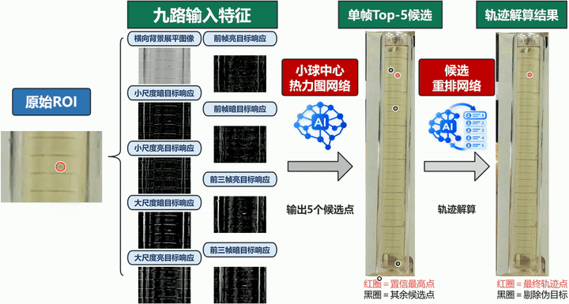

# FallingBallTube / 落球管追踪

面向落球法实验的 Android 应用：通过相机实时测量或导入本机视频，识别试管与刻度、
追踪小球、拟合终端速度，并在实验参数完整时计算动力黏度。测量结果保存在本机，
支持曲线查看、参数重算和 CSV 导出。

检测使用 YOLOv8n-OBB 识别试管、9 通道 TinyHeatmapNet 定位小球；小球模型当前按
**QNN HTP NPU → ONNX Runtime CPU** 尝试初始化（NCNN 链路因无 9 通道导出而显式跳过）。
QNN 上下文按 SoC 选架构：**Hexagon v75**（8 Gen 3 / SM8650）与 **v73**（8 Gen 2 / SM8550、
8s Gen 3 / SM8635）各有一份 context binary，其余设备保留 CPU 回退；是否实际启用硬件加速以运行日志为准。

> **⚠️ 项目现状（2026-11-11 更新）**：最后一次功能提交为 2026-09-13（`5fe6b8a`）；2026-11-11 新增
> 文档治理提交与 `wip/learning-evidence-gate` 分支（未合并）。历史项目内最后一次改动为 2026-09-22。
> 生产模型已是 **9 通道 causal9 heads**（契约
> `tinyheatmapnet-android-causal9-heads-20260913-v1`），下文「模型」「小球识别加速」章节中的
> 5 通道 / NCNN 描述属于历史实现，以本段说明、[`AGENTS.md`](AGENTS.md) 和
> [`docs/DEPLOY_CAUSAL9.md`](docs/DEPLOY_CAUSAL9.md) 为准。
>
> **AI 协作**：新会话/新模型接手前请先读根目录 [`AGENTS.md`](AGENTS.md)（项目总览、数据代次规则、
> 真机安全、任务记录与清理规范）。

[系统概览](#系统概览) · [快速运行](#打开与运行) · [相机测量](#落球测速) · [视频分析](#导入视频分析) ·
[工程结构](#工程结构) · [模型与加速](#小球识别加速当前实现和证据)

## 系统概览

[](docs/images/system-overview.png)

*图 1 · 测量流程与诊断反馈示意。* 从视频采集、管体定位与标定、小球追踪到终端速度和黏度计算，
串联结果归档与 AI 学习助手；红色虚线表示过程诊断、异常提示和重测反馈。点击图片可查看原图。

## 功能

- 后置相机实时预览与旋转框（OBB）检测
- 导入本机原速 SDR 视频，选择片段后按原视频时间戳逐帧分析；支持后台进度、取消和结果保存
- 自动/手动对焦、设备支持的镜头与变焦控制；调节后重新建立刻度和背景。控件常驻扁平一行 40dp
  （镜头切换、倍率预设、AF/MF 圆钮、展开），点展开才出现上下两行各 40dp 的对焦标尺与倍率滑杆，
  静置 5 秒或开始测量时自动收起，把预览空间还给管体
- 相机页底部只有一行操作：[开始追踪小球] 加「参数 / 重新识别 / 视频分析 / 记录」四个紧凑按钮
- 时序锁定与平滑（抗手抖），支持倾斜管体
- 默认分析分辨率 **720p**，可切换 **1080p**
- “参数”弹窗内可切换 YOLO 输入 **320 / 416 / 512 / 640**；低档蓝框更实时，高档细节更准确
- 相机页固定为两行简要状态；完整性能、温控和门控诊断写入后台滚动日志
- 相机侧边水平指示器：手机平视时显示绿色，超过 ±10° 显示文字提醒
- 尽量开启 OIS/EIS（设备不支持则自动回退）
- 「重新识别」按钮
- 刻度线检测、时序配准与毫米标定
- 黄色中央带只提取刻度线；宽暗影会被屏蔽出刻度候选，再由 TickRuler 做跨帧身份稳定，避免小球被当成刻度
- 在稳定后的 `152x1024` 灰度试管 ROI 上运行与 PC 同源的 TinyHeatmapNet，并由 CandidateReranker 对每帧 top-5 候选重排
- 追踪过程中显示当前帧最高分候选；测量结束后对完整候选序列执行双向 Viterbi，序列不满足验收条件时保留既有因果轨迹回退
- 开始测量前会按真实时间间隔验证连续向下运动；检测器不可用或执行失败时会明确报错，旧一维诊断结果不会进入新测量
- 根据二维球心、球径和管内径识别持续贴壁；画面、历史记录和 CSV 均保留贴壁状态，贴壁时警告中心轴黏度公式不适用
- 被拒绝的刻度帧不参与背景，刻度身份丢失后会自动重建，避免旧背景套到新刻度上
- 稳定段终端速度估计会按有效球位置采样率自适应速度窗口，并隔离短暂反向跳点；CSV 明确保存拟合与异常标记
- 完成的测量会自动保存在本机；全屏“记录”页面提供位移—时间图、虚拟化逐帧列表、编辑、删除和单条导出
- 测量记录列表支持**长按**：删除会先移入回收站（可撤销/恢复），也可设置低饱和度颜色标记（蓝/绿/黄/粉/紫/橙，可清除；无标记时「清除标记」置灰不可点）；标记保存在本机、不修改原始测量数据
- 记录列表右侧用简略示意图显示实验条件（球径 1–5 mm 对应球的大小、管径 10–50 mm 对应管的宽窄，超出范围按边界绘制；图下小字显示球径/管径数值）；球与管的颜色按材质/液体关键词区分（钢/陶瓷/铜；蓖麻油/甘油（=丙三醇）/硅油/水），点击示意图可查看完整参数卡；列表时间只显示到分钟（记录本身仍保留秒）
- 记录页支持**搜索**（名称/液体/材质/温度）；搜索框右侧**漏斗图标**打开筛选：颜色可**多选**、日期可选**今天/近三天/近一周/近一个月/自定义范围**、排序可选**时间/速度/黏度**；标题栏「回收站」可恢复、永久删除已删除记录或清空回收站
- 长按菜单可进入**多选**：每行出现选择框，标题栏出现 × / √，支持**全选/取消全选**并实时显示已选条数；√ 对选中记录批量设置颜色、清除标记或删除（删除同样可撤销）
- 可选填写球/管尺寸、液体/小球密度及实验元数据；稳定段存在且参数完整时计算 Faxén/Haberman-Sayre 管壁修正与一阶 Oseen 动力黏度
- 历史记录保留不可变的原始格数和二维像素坐标；修改每格距离会重新计算纵横向毫米坐标、贴壁状态、速度、稳定段、拟合和黏度

## 环境要求

| 项目 | 当前配置 |
| --- | --- |
| Android Studio | 支持 Android Gradle Plugin 8.7.2 的版本，如 Ladybug 或更新版本 |
| JDK / Gradle | JDK 17；仓库提供 Gradle 8.9 Wrapper |
| Android SDK | Platform 35；`compileSdk` / `targetSdk` 为 35，`minSdk` 为 26 |
| 原生构建 | NDK `27.0.12077973`、CMake `3.22.1`、C++17 |
| QNN SDK | Qualcomm QAIRT / QNN SDK 2.50；通过 `QNN_SDK_ROOT` 指定完整 SDK 根目录 |
| 设备 | Android 8.0+，仅打包 `arm64-v8a`；相机实测建议使用 ARM64 真机 |

在 Android Studio 的 SDK Manager 中安装 SDK Platform 35，并在 SDK Tools 的
“Show Package Details”中选择上述 NDK 和 CMake 版本。真机调试需要开启 USB 调试。
QNN HTP 加速受 SoC、Hexagon 架构和设备系统支持限制，不代表所有 ARM64 手机均可用。
QNN 头文件和 `libQnn*.so` 不随源码仓库分发。新克隆的项目需要准备完整的 QAIRT SDK 2.50，
包括 `include/QNN/QnnInterface.h`、Android ARM64 运行库及 Hexagon v75 运行库。
在启动 Android Studio 或命令行构建前设置环境变量，例如：

```powershell
$env:QNN_SDK_ROOT = '<QAIRT SDK 目录>'
```

构建会从该 SDK 读取头文件，并将所需的 QNN 运行库复制到构建输出目录后打包进 APK，
无需手工复制到源码目录。NCNN 头文件和 ARM64 `libncnn.so` 保留在仓库中。

## 打开与运行

```powershell
git clone https://github.com/XuanRen-P/FallingBallTube.git
cd FallingBallTube
```

1. 安装 [Android Studio](https://developer.android.com/studio)
2. 克隆仓库后，用 **Open** 打开项目根目录 `FallingBallTube`
3. 等待 Gradle Sync 完成（首次会下载依赖）
4. 用 USB 连接手机，点击 Run

若 Sync 提示缺少 `local.properties`，用 Android Studio 打开工程后会自动生成 SDK 路径；也可手动创建：

```properties
# 替换为本机 Android SDK 的实际路径；Windows 也可使用正斜杠。
sdk.dir=C:/Users/<你的用户名>/AppData/Local/Android/Sdk
```

仓库包含 Gradle Wrapper，不需要单独安装 Gradle。Windows 终端可执行：

```powershell
.\gradlew.bat :app:testDebugUnitTest :app:lintDebug :app:assembleDebug
```

macOS/Linux 对应命令为 `./gradlew :app:testDebugUnitTest :app:lintDebug :app:assembleDebug`。
首次构建需要联网下载依赖；依赖缓存齐全后才可追加 `--offline`。Debug APK 位于
`app/build/outputs/apk/debug/app-debug.apk`。

普通相机和视频测量无需 API Key。可选 AI 数据讲解使用阿里云配置 CSV：默认读取
项目根目录下被忽略的 `.secrets/aliyun-api-key.csv`，也可通过 `local.properties` 的
`aliyunApiKeyCsv`、Gradle `-PaliyunApiKeyCsv=...` 或 `ALIYUN_API_KEY_CSV` 环境变量指定。
CSV 支持 `apiKey`、`openAiCompatible` 和 `workspaceId` 键；CSV 不纳入版本控制。

真机仪器测试沿用[保留数据的测试流程](docs/ANDROID_DEVICE_TESTING_INCIDENT_2026-08-14.md)；
项目已禁止可能卸载主应用的 Gradle `connected...AndroidTest` / `device...AndroidTest` 任务。

## 相机预览

1. 竖屏手持，将落球管放在画面中心引导框内
2. 等待状态从「搜索中」变为「已检测到玻璃管」
3. 框飘了或换管子：点「重新识别」
4. 需要更清晰边缘时可切 1080p（更耗电）

## 落球测速

1. 点「参数」填入**每格间距（mm）**和**刻度线总数**（总数可留空）。小球直径、管内径、两种密度、液体名称、球材质和温度都是可选默认值，不填写也可测速
2. 对准空量筒，等待状态从「刻度线已锁定，正在建立空管背景」变为「刻度线已锁定」
3. 点「开始追踪小球」，投球；单帧暗影不会启动测量，连续向下运动确认后才正式记录并补回确认期帧
4. 小球到底或丢失会自动结束并弹出结果；也可手动「停止追踪」
5. 测量结束后会自动保存到「记录」；打开记录会关闭相机，返回测量页后重新锁定刻度并建立新的空管背景
6. 记录详情中可查看位移—时间图和逐帧数据。绿色点是终端速度拟合的实际输入；白色异常点保留原始位置但不参与计算，曲线在异常点处断开；缺失位移不会被插值
7. 可为单条记录补充或修改实验参数与每格距离；补齐有效参数后自动给出 Pa·s 和 mPa·s，并显示管壁修正因子、修正速度、Re 和可靠范围警告

结果给的是**终端速度**（对稳定段的位置做线性回归），不是最后一帧的瞬时速度。如果没找到稳定段会明确说"未达到稳定速度"而不是给个假数。

> 追踪期间建议切 **1080p**：采样点数量直接决定精度，而粘度 ∝ 1/v，误差会原样传进结果。
> 有效球位置低于 10fps 时，速度回归窗口会按实际帧间隔自适应放宽，并明确提示低时间分辨率；稳定判据本身不会放宽。

## 导入视频分析

1. 在相机页点「视频分析」→「导入视频」，通过系统文件选择器选择本机原速 SDR 视频。
2. 选择包含投球前清晰空管画面的片段，核对刻度间距与实验参数。
3. 勾选「已确认视频为原速，未慢放或变速」，点「开始离线分析」。
4. 等待进度完成，点「查看分析结果」或进入「记录」；每次分析保存片段内的第一次有效下落。

分析使用原视频尺寸和时间戳，YOLO 固定为 640 档；处理速度不会改变实验时间。
支持后台与锁屏处理，取消不会保存部分记录；系统中断后恢复的任务会从片段起点重算。
视频分析期间相机测量暂停。详细行为和已有真机验证见
[相机控制与离线视频分析](docs/CAMERA_VIDEO_ANALYSIS.md)。

## 工程结构

```
app/src/main/
  assets/                        # 随 APK 打包的运行时模型、契约和学习资料
  cpp/                           # JNI、NCNN/QNN 桥接与 NCNN 头文件
  jniLibs/arm64-v8a/              # ARM64 libncnn.so；QNN 运行库由本机 SDK 提供
app/src/main/java/com/cupet/fallingball/
  MainActivity.kt                 # 相机模式、系统栏 inset、detector 生命周期
  MeasurementHistoryActivity.kt  # 全屏记录列表、详情、逐帧数据、编辑与导出
  camera/CameraController.kt      # CameraX、防抖、YUV→RGB→letterbox 预处理
  camera/MeasurementFrameProcessor.kt # 相机与离线视频共用测量核心
  video/VideoAnalysisActivity.kt  # 视频导入、片段选择、参数和任务进度
  video/VideoFrameDecoder.kt      # 原尺寸 MediaCodec 解码与视频时间戳
  video/VideoAnalysisWorker.kt    # WorkManager 后台分析、取消和记录保存
  learning/                      # 可选 AI 数据讲解、知识索引与会话记录
  vision/ObbDetector.kt           # ONNX 推理 + OBB 后处理（NMS、坐标反映射）
  vision/TubeTracker.kt           # 锁定 / 相机帧驱动的 SmoothStep 几何过渡
  vision/TubeModels.kt            # WallLine / TubeObservation / TubeTrackResult / TrackMode
  vision/RegisteredBallDetector.kt # 旧一维算法的隔离实现/单元测试，不接入新测量主链
  vision/TinyHeatmapNetBallDetector.kt # TinyHeatmapNet + CandidateReranker 主检测链
  vision/TinyHeatmapSequenceDecoder.kt # 与 PC 同语义的完整候选序列 Viterbi
  vision/TubeRoiSampler.kt        # CameraX Y 平面到 160x1024 试管坐标
  vision/BallGeometry.kt          # 二维球心反投影与贴壁判断
  analysis/FallTrackingGate.kt    # 等待投球、确认下落、正式追踪与结束门控
  camera/AnalysisLoadPolicy.kt    # 温度分级与 YOLO/小球检测动态降载预算
  camera/DeviceThermalMonitor.kt  # Android 热状态和电池温度适配
  camera/RuntimeDiagnosticsRecorder.kt # 有界后台性能日志
  analysis/MeasurementHistoryStore.kt # 本地测量记录的版本化读写、排序与删除
  analysis/ViscosityCalculator.kt # Stokes + 圆管壁面修正 + 一阶 Oseen 纯计算模块
  vision/CameraLevelEstimator.kt  # 重力向量到相机俯仰角的平滑换算
  ui/OverlayView.kt               # 旋转框绘制
  ui/LevelIndicatorView.kt        # 侧边水平刻度与超限提醒
  ui/AnalysisResolution.kt
app/src/test/                    # JVM / Robolectric 回归测试与基准数据
app/src/androidTest/             # 真机解码与离线视频等仪器测试
dev_tools/                      # Python 诊断、数据处理、训练与回放工具
docs/                           # 实现说明、测试流程与历史实验台账
gradle/wrapper/                  # 可复现的 Gradle 启动配置
```

### 仓库内容与本地资料

源码库保留应用源码、构建脚本、测试、文档、运行时模型和 NCNN 原生依赖；QNN SDK 在本机准备。
第三方组件与 QNN SDK 的获取边界见[第三方说明](docs/THIRD_PARTY_NOTICES.md)。
`local.properties`、密钥文件、IDE/Gradle/Python 缓存、构建产物、训练 `runs/` / `outputs/`、
实验视频、设备私有数据备份和历史 ZIP 归档留在本机，不纳入源码提交。
文档中提到的本地实验目录用于保留溯源位置，克隆仓库后不会自动获得这些数据。
训练和真机回归需要自行准备相应视频、标注及开发环境。

## 模型

生产推理加载试管 OBB 模型和 TinyHeatmapNet 小球检测模型；旧 ConvGRU 模型已从 APK 和 Android
代码中移除，历史 PC 训练/回放脚本不属于当前生产检测链。
`app/src/main/assets/best.onnx` 检测试管 OBB；它是动态尺寸模型，输入为
`(1,3,H,W)` NCHW float32 [0,1]，当前提供 320、416、512、640 四个方形档位；
输出为 `(1,6,anchors)`，六个通道是
`[cx, cy, w, h, confidence, angle_rad]`，anchor 数量由输入档位决定。

手机界面的“参数”弹窗用于选择 YOLO 输入档位。相机页固定只显示两行摘要：相机采样
FPS、YOLO 输入尺寸、蓝框更新 FPS、最近一次推理耗时和置信度。TinyHeatmapNet、门控、温度和
完整耗时只写后台日志，不再占用预览画面。
相机分辨率决定刻度采样细节，YOLO 输入尺寸决定检测框的速度/精度，两者互不替代。

### 小球定位与轨迹解算

[](docs/images/pipeline_9ch_20261116.gif)

*图 2 · 小球定位与轨迹解算流程。* 9 通道输入（5 路空间特征 + 4 路 lag{1,3} 因果运动差分）进入 TinyHeatmapNet，生成球心热力图与亚像素偏移，
再提取每帧 Top-5 候选。候选重排网络结合局部特征及前 1 / 前 3 源帧的运动差分评分；测量结束后，
由独立的双向 Viterbi 解码器选择完整轨迹，并按既有验收规则决定是否采用。点击图片可查看原图。

## 小球识别加速：当前实现和证据

这部分用大白话说就是：先把试管裁成一条固定的细长图片，再让小球模型在这条
图片上找球。真正需要加速的是 TinyHeatmapNet 的 parent 图；后面的候选重排、时序
选择和物理计算仍然保留在原来的 Kotlin/CPU 逻辑中，不能只看一个“模型毫秒数”就
宣称整条 App 已经达到目标帧率。

### 固定契约

> **历史契约提示**：以下为 2026-08～09 初的 5 通道契约。当前生产契约是
> **`causal9-heads-20260913-v1`**（9 通道，输入 `[1, 9, 1024, 152]`，parent 为
> `tinyheatmapnet_causal9_heads.onnx` + 1.2 MB QNN context），见 [`AGENTS.md`](AGENTS.md) §1.3 与
> [`docs/DEPLOY_CAUSAL9.md`](docs/DEPLOY_CAUSAL9.md)。

- parent 输入：`[1, 5, 1024, 152]`，`float32`
- parent 输出：heatmap `[1, 1, 512, 76]`、offset `[1, 2, 512, 76]`
- Android 生产模型：`app/src/main/assets/tinyheatmapnet_final.onnx`
- GPU 图：`app/src/main/assets/tinyheatmapnet_final.ncnn.param` +
  `app/src/main/assets/tinyheatmapnet_final.ncnn.bin`
- 契约、SHA-256 和 ONNX/NCNN 数值对齐记录：
  `app/src/main/assets/tinyheatmapnet_contract.json`

### Android 运行顺序

> **历史顺序提示**：以下 1–2 条描述 5 通道时代的 QNN sep / NCNN Vulkan 回退；当前 9 通道生产
> 路径为 **QNN HTP → ORT CPU**，NCNN 被显式跳过（见 [`docs/DEPLOY_CAUSAL9.md`](docs/DEPLOY_CAUSAL9.md)）。

1. 首次推理优先尝试 QNN HTP，加载 `tinyheatmapnet_sep_qnn_context.bin`；它是保留
   GroupNorm 权重、对池化与归一化算子改写后的 FP16 上下文，目标为 Hexagon v75。
2. QNN 创建失败时尝试 NCNN Vulkan；NCNN 必须提供运行时 placement 证据才可进入生产路径。
   当前 JNI 只有 Vulkan 能力预检，尚不提供这一证据，因此该路径会被拒绝并继续回退。
3. 硬件后端均不可用时使用 ONNX Runtime FP32 CPU。硬件后端预热或推理期间失败也会
   关闭该后端并直接切到 CPU，避免逐帧重试。
4. 每个后端仅做一次预热；候选重排、轨迹、视频时间戳和物理拟合沿用共用处理逻辑。

QNN 需要设备可用的 HTP/FastRPC 运行环境。构建通过 `QNN_SDK_ROOT` 读取本机 SDK 的
头文件与运行库，再将所需库集成到 APK；使用的 QNN v75 依赖不保证适用于其他 Hexagon 架构。

后台日志中的关键字段：

```text
tinyBackend=qnn_htp_context/NPU # 实际后端和计算单元；也可能为 ort_cpu/CPU
tinyWork=submitted/completed/dropped/failed
tinyFps=...                      # 成功完成的有效帧率，不是相机回调帧率
parentP50=... parentP95=...
```

QNN 就绪时日志为 `backend=qnn_htp_context computeUnit=NPU placementVerified=true`，
其证据来自在真实 HTP 设备上成功加载专用上下文。NCNN 只有明确报告
`backend=ncnn_vulkan computeUnit=GPU placementVerified=true` 才能记为 GPU 成功；
静态 `support_vulkan` 预检不能替代运行时证据。`ort_nnapi_requested` 也只表示请求过 NNAPI。

2026-09-04 的小米 14 Ultra 记录显示 QNN HTP 已实际运行；同一 3 mm 场景经管线和预热
修正后，有效 FPS 从原始基线 7.05 提升至 12.15。该结果受场景与设备限制，不作为所有机型
的性能保证。后续离线视频已完成 4K 样片的 681 帧解码、处理与小球检测验证，见
[相机与视频验证记录](docs/CAMERA_VIDEO_ANALYSIS.md)；加速迭代过程见
[历史任务台账](docs/ACTIVE_TASKS.md)。

2026-09-03 已在 Qualcomm AI Hub 的 `Samsung Galaxy S24 (Family)`（Snapdragon 8 Gen 3 /
SM8650、Android 14）完成真实 compile/profile/inference。生产模型 GPU profile 为
`29.298 ms p50 / 32.152 ms p95`，仅 `22` 层 GPU、`187` 层 CPU；HTP/NPU profile 为
`10.001 / 10.084 ms` 且 `94` 层 NPU，但固定输入与 ORT CPU 的最大误差为 heatmap
`9.580595`、offset `0.531688`，数值验收失败。完整 job、层级落点和输出比较原保存在本地
`dev_tools/ball_video_lab/runs/aihub_live_20260903/`（不随仓库分发）。这组早期实验与后续
已接入的 `sep` QNN 上下文不同，也不是完整 CameraX App 的端到端 FPS 证据。

### 本地和 Android 验证

先在电脑上跑固定测试（不会上传模型）：

```powershell
Push-Location .\dev_tools\ball_video_lab
python -m pip install -r requirements.txt pytest
python -m pytest -p no:cacheprovider tests

Pop-Location
.\gradlew.bat :app:testDebugUnitTest :app:lintDebug :app:assembleDebug --no-daemon
```

有 Android 真机时，不要手工让相机页面空跑；使用有界 runner。现有 runner 的
NCNN parent benchmark 命令是：

```powershell
.\test_app.cmd --benchmark-tiny-ncnn --serial <设备序列号>
.\test_app.cmd --benchmark-tiny-parent --serial <设备序列号>
```

它会在结束路径 force-stop 主 App，但不会卸载或清除 `com.cupet.fallingball` 的数据。
从 logcat 保存 `TinyHeatmapBenchmark`、`FallingBallPerf` 和温度信息，再把 parent 延迟、
有效 FPS、丢帧数和质量结果一起比较。`--benchmark-tiny-ncnn` 的两个结果分别是
NCNN CPU 和 NCNN Vulkan；它只测 parent 图，不能替代完整视频回放。

<details>
<summary>展开训练、云端加速实验与诊断命令（含历史证据）</summary>

## BatchNorm / NPU 候选模型

早期 FP32 GroupNorm 模型包含 13 个 `InstanceNormalization`，曾探索 BatchNorm student
作为硬件友好候选。仓库提供了 `dev_tools/ball_video_lab/train_hardware_friendly_student.py`：以 GroupNorm
teacher 加人工标签蒸馏出无 InstanceNorm 的 BatchNorm student；再用
`validate_hardware_friendly_onnx.py` 检查固定输入输出和算子。

候选模型必须用同一份 holdout、同一套候选重排和完整视频轨迹验收。比较工具为
`dev_tools/ball_video_lab/compare_tinyheatmap_candidates.py`，默认保护已有输出目录，
也不会自动复制候选模型进 APK。该批次的实际结果是：GroupNorm 约 91.53% ball
recall，BatchNorm 约 86.21%，另有 2.5 mm 的异常长尾，因此候选**未通过质量门、未进入
生产**。这不是“结构能导出”就算成功；后续必须先修复/重训质量，再谈 NPU。

## Qualcomm AI Hub：只在明确执行时上传

AI Hub 可以在云端真实 Snapdragon 设备上做 compile、profile 和 inference。默认工具只
生成计划，不读取令牌、不上传模型：

```powershell
Push-Location .\dev_tools\ball_video_lab
python aihub_tinyheatmap.py list-devices `
  --chipset "qualcomm-snapdragon-8gen3" `
  --output-dir "..\..\runs\aihub_list_devices_plan"
```

本节命令在 `dev_tools/ball_video_lab` 目录内依次执行。需要真正提交时，先通过本机凭据管理
方式向当前会话注入 `QAI_HUB_API_TOKEN`（不要把 token 写进脚本、文件或命令历史），
并在专用环境安装 `qai-hub`：

```powershell
python -m pip install -r requirements-aihub.txt
```

建议顺序如下。`<设备名>` 必须是 `list-devices` 返回的精确名称；不要猜设备名。

```powershell
# 1) GPU：先编译 TFLite，再 profile GPU
python aihub_tinyheatmap.py compile `
  --model "..\..\app\src\main\assets\tinyheatmapnet_final.onnx" `
  --device "<设备名>" --backend gpu --precision fp16 --wait `
  --output-dir "..\..\runs\aihub_gpu_compile"

# 2) NPU：先用硬件友好 student；生产 GroupNorm 失败也要保留失败证据
python aihub_tinyheatmap.py compile `
  --model "<student.onnx>" --device "<设备名>" --backend npu --precision fp16 --wait `
  --output-dir "..\..\runs\aihub_npu_compile"

# 3) 对 compile 成功得到的 target-model/id 做 profile
python aihub_tinyheatmap.py profile `
  --model "<target-model-or-id>" --device "<设备名>" --backend gpu --wait `
  --profile-output "..\..\runs\aihub_gpu_profile\profile.json" `
  --output-dir "..\..\runs\aihub_gpu_profile"
```

如需比较输出，先从一个 validation ROI 生成固定输入；工具不会偷偷 resize、transpose
或把 test split 当 validation：

```powershell
python make_aihub_input.py `
  --manifest outputs\multidiameter_heatmap_dataset\manifest.csv `
  --split validation --row 0 `
  --output outputs\aihub_sample\validation_000.npz
```

随后对已编译 target model 做 inference，并把下载的两个输出与 ORT CPU 参考比较：

```powershell
python aihub_tinyheatmap.py inference `
  --model "<target-model-or-id>" --device "<设备名>" --backend npu `
  --input-npz outputs\aihub_sample\validation_000.npz --wait `
  --output outputs\aihub_sample\remote_outputs.h5 `
  --reference-model "..\..\app\src\main\assets\tinyheatmapnet_final.onnx" `
  --comparison-output outputs\aihub_sample\comparison.json `
  --output-dir "..\..\runs\aihub_inference"
```

profile 结果要同时记录 compute unit、延迟、内存和层映射；仅仅看到 job 成功或 provider
列表不能证明整图落在 GPU/NPU。NPU 若大量回落 CPU，或比 GPU 慢，就不进入生产；即使
AI Hub 模型速度很好，也还要通过 Android 完整 CameraX 回放和 5 分钟热稳定性验收。
完成本节操作后执行 `Pop-Location` 返回仓库根目录。

## YOLO dataset2 溯源和验证

YOLO 训练工作区和原始数据位于仓库之外，需要另行准备；下文的 `$yoloRoot` 表示该工作区。
训练入口为 `train_obb.py`，数据目录为 `dataset2`，不要误用指向旧 `dataset` 的 `data.yaml`。
从本仓库根目录先做只读审计：

```powershell
$yoloRoot = '<本机 YOLO 工作目录的绝对路径>'
Push-Location .\dev_tools\ball_video_lab
python audit_yolo_dataset2.py `
  --dataset-root "$yoloRoot\dataset2" `
  --output-dir "outputs\yolo_dataset2_audit"
```

原始树发现的越界坐标不会被静默改写；如需训练，先生成安全副本，再把生成的
`dataset2.yaml` 显式传给训练脚本：

```powershell
python repair_yolo_dataset2.py `
  --source-root "$yoloRoot\dataset2" `
  --destination-root "$yoloRoot\dataset2_repaired"

python "$yoloRoot\train_obb.py" `
  --data "$yoloRoot\dataset2_repaired\dataset2.yaml" `
  --export-onnx
```

导出的 OBB 模型要用专用工具检查：

```powershell
python validate_yolo_obb_onnx.py `
  --model "$yoloRoot\runs\<本次训练>\weights\best.onnx" `
  --output "runs\yolo_dataset2_contract.json"
python benchmark_yolo_onnx.py `
  --model "$yoloRoot\runs\<本次训练>\weights\best.onnx" `
  --provider cpu --warmup 5 --iterations 30 `
  --output "runs\yolo_dataset2_cpu_benchmark.json"
```

`validate_yolo_obb_onnx.py` 是试管 OBB 专用 validator，不能拿它检查
TinyHeatmapNet；后者的固定 parent 契约由 `aihub_tinyheatmap.py`、
`validate_hardware_friendly_onnx.py` 和 `tinyheatmapnet_contract.json` 共同约束。
完成本节操作后执行 `Pop-Location` 返回仓库根目录。

## Qualcomm AI Hub 实测结果（2026-09-03）

已使用 `qai-hub==0.55.0` 执行真实云端任务，不是 dry-run。`list-devices` 返回并实际使用
的设备为 `Samsung Galaxy S24 (Family)`（Android 14、Snapdragon 8 Gen 3/`SM8650`、HTP
v75）。设备清单见 `dev_tools/ball_video_lab/runs/aihub_live_device_probe_20260903/`；完整
job 证据见 `dev_tools/ball_video_lab/runs/aihub_live_20260903/`。

固定输入是 `[1,5,1024,152]` float32，SHA-256 为
`bc31cc69489d496f67ea4edaab9a8198b97a8ef8de1def356a17ac7b3208bc53`。生产模型
`tinyheatmapnet_final.onnx` SHA-256 为
`4c21973c321a3f77153453cb786fc15ee6fef3d93d416a1c5323b7dae6058fb6`。

| 路径 | Compile → target | Profile | 实际 placement | p50 / p95 | 峰值内存 | inference 数值验收 |
| --- | --- | --- | --- | ---: | ---: | --- |
| 生产 GPU FP16 | `j5w709e6g` → `mn7zxr33m` | `jp416wlvp` | GPU 22 层 / CPU 187 层 | 29.298 / 32.152 ms | 177.801 MB | `jgnnde6rg` 通过；heatmap/offset 最大误差 0.0207977 / 0.00175339 |
| 生产 HTP/NPU FP16 | `jgk4wye2p` → `mm5le86kq` | `jglx9kv8g` | NPU 94 层 / CPU 0 层 | 10.001 / 10.084 ms | 178.898 MB | `j5741d2l5` 失败；最大误差 9.580595 / 0.531688 |
| BatchNorm student HTP FP16 | `jpyxkdz75` → `mnj9454kq` | `jgk4wyv2p` | NPU 52 层 / CPU 0 层 | 6.503 / 6.599 ms | 143.863 MB | `jpvdywqjp` 失败；最大误差 9.099943 / 1.747628 |

这里的 GPU 结果是**部分 GPU placement**，不是整图 GPU：profile 同时报告了 187 个 CPU
层。两个 HTP profile 确实整图落在 NPU，但 inference 输出与本地 ORT CPU 参考不一致，
所以这两个 2026-09-03 的 HTP 候选不能因为“速度快”而切换。BatchNorm student 另外还
未通过冻结视频质量门，保留为实验资产。随后接入的 `sep` QNN 上下文使用不同图改写，
其后续数值与真机记录见前述当前实现和历史台账；不能将两批模型混为一谈。

## 当前验证边界

- QNN HTP 已有真实设备运行证据，仍保留 ONNX Runtime FP32 CPU 回退。
- NCNN Vulkan 尚缺运行时 layer placement 证据，不能宣称该路径已实现生产 GPU 加速。
- 已记录的 CameraX 场景为约 12 FPS，尚未证明达到原先至少 15 FPS、理想 20 FPS 的目标。
- 逐直径/材质的物理管路直拍、跨设备质量与更长时间热稳定性仍需补齐；短视频、拍屏和
  单次云端 profile 不能替代实际实验验收。

模型速度、有效检测帧率和物理测量质量应分别检查，不要仅凭 PC CPU 或 AI Hub 的
单次 parent 毫秒数修改生产阈值。文中的本地 `runs/` 证据目录不随源码分发。

后台日志每两秒写入一次，单文件上限 256 KiB，自动保留上一份。Debug 包可直接读取：

```powershell
adb shell run-as com.cupet.fallingball cat files/diagnostics/runtime.log
adb logcat -s FallingBallPerf
```

Debug APK 还会在每次“开始追踪小球”时自动创建独立的追踪诊断包。即使最终没有
任何轨迹点，记录页也会保留一条灰色、不可点击的“仅日志”记录。完成手动试验后，可在
仓库根目录执行只读采集：

```powershell
.\collect_tracking_diagnostics.cmd
.\analyze_tracking_diagnostics.cmd .\runs\tracking_diagnostics\<采集时间戳>
```

采集命令会先 `force-stop` APP 以关闭摄像头，再通过 `run-as` 复制
`files/diagnostics/tracking_sessions/`；不会删除手机上的诊断、测量或偏好。分析结果为每个
会话生成 `timeline.csv`、`timeline.png` 和 `analysis.json`，并在根输出目录生成
`aggregate.json`。需要让零轨迹会话在自动检查中返回非零状态时，可追加
`--fail-on-zero`。当前诊断逐帧记录 TinyHeatmapNet 峰值、候选数量和拒绝原因；历史
ConvGRU 对拍脚本不属于当前生产检测链。

### 一键真机视频回归

手机已经通过无线 ADB 连接并对准电脑屏幕后，在仓库根目录执行：

```powershell
.\test_app.cmd
```

脚本会先把桌面播放器置于全屏首帧，再启动 APP、重新识别刻度线、等待
TinyHeatmapNet 建立输入状态、开始追踪并播放开发视频。它会在关键时刻保存
截图和日志，拉取新生成的 FBR，检查每个样本是否包含二维横向坐标和贴壁状态，
最后无条件关闭 APP。结果保存在 `runs/device_debug/automated/<时间戳>/`。

只检查环境而不打开 APP：

```powershell
.\test_app.cmd --dry-run
```

默认使用开发视频 `1mm_gang_30.5_03.mp4`；脚本会拒绝已经冻结的
`_09` / `_10` 最终测试视频。

APP 同时监听 Android 热状态和电池温度，按温度降低 YOLO 预算；低成本的原分辨率刻度
采样不降频。TinyHeatmapNet 使用独立单 worker 和 busy 防重入，上一帧尚未算完时直接跳过新任务。

TinyHeatmapNet 每次读取当前稳定灰度 ROI，生成 5 通道空间特征和 4 通道因果运动特征；
候选重排器处理 17x17 局部块，结束时由 Viterbi 选择完整轨迹。模型与候选参数以
`app/src/main/assets/tinyheatmapnet_contract.json` 固定。

换模型的完整流程（导出、验证、通道含义、预处理对齐、常见坑）见
[YOLO_OBB_Android_Integration_Guide.md](YOLO_OBB_Android_Integration_Guide.md)。

仓库根目录的 `best.pt` / `best.onnx` 是被忽略的本地训练、导出产物，可以与
APK 内模型不同。更新运行时模型时必须先确认它是动态尺寸导出，并验证四档输入、
输出形状和通道含义，再显式复制：

```powershell
Copy-Item .\best.onnx .\app\src\main\assets\best.onnx
.\gradlew.bat testDebugUnitTest assembleDebug
```

`app/src/main/assets/best.onnx` 必须保持被 Git 跟踪，否则新克隆的仓库会在
`ObbDetector` 初始化时因缺少模型而失败。不要依赖根目录同名文件自动同步。

</details>

## 调参入口

- `DetectionRoi`（`vision/TubeModels.kt`）：**相机模式**只检测画面中间
  **横向 70%**（排除左右各 15%）、**纵向 90%**（排除上下各 5%）。
  边缘区域根本不会被采样进模型，所以台面上的杂物不可能产生误检。
  界面上的白色引导框就是按这四个常量画的，改常量框会跟着动。
- `ObbDetector`
  - `CONF_THRESHOLD`：**当前 0.7**，只有置信度超过它的检测才会被接受（ultralytics 默认是 0.25）。
    如果真管子经常检不出来，往下调
  - `IOU_THRESHOLD` / `MAX_DET`：NMS 参数
  - `DEBUG_DUMP`：对拍 PC 诊断脚本时开
  - `LOG_TIMINGS`：逐帧打印推理耗时，平时关（每帧一次 `String.format`）
- `ModelProfile`：320/416/512/640 四档 YOLO 输入尺寸；默认 640，选择会在手机上保存
- `TubeTracker` 构造参数：锁定帧数、丢锁毫秒数、平滑系数
- `TickDetector`：宽暗斑屏蔽门、强峰筛选（`STRONG_REF_TOP_K`）、缺口填补；宽暗斑只用于保护刻度候选，不作为小球输出
- `TickRuler`：校验门阈值、状态机的 250ms/1000ms 时间边界、粗细配准窗口
- `RegisteredBallDetector`：旧一维算法的隔离实现，仅保留回归测试，不接入 APP 运行参数
- `TinyHeatmapNetBallDetector`：5+4 通道预处理、top-5/NMS、候选重排和 PC 固定模型契约
- `FallTrackingGate`：主检测候选确认时间、最小向下位移、小球丢失超时与触底阈值
- `VelocityEstimator`：`WINDOW_MS`（瞬时速度回归窗）、平台判据

`signal/`、`analysis/`、`TubeAxis`、`TickRuler` 不含任何 Android import，所以能直接跑 JVM 单测：
`.\gradlew.bat testDebugUnitTest`。`signal/` 的基准数据由真实 scipy 生成；需要更新时执行：

```powershell
python -m pip install -r dev_tools/requirements.txt
python dev_tools/gen_golden_vectors.py
```

生成后应确认 `app/src/test/resources/golden_vectors.txt` 只有预期变化。**这条边界要守住**——
一旦被测代码引入 Android 类型，JVM 测试就无法独立运行。

界面右上角的 meta 行会实时显示 FPS 和 conf，调参时看这里比看 logcat 快。

## 真机验收清单

- 首次启动请求相机权限，拒绝时给出明确提示
- 720p/1080p 能切换；设备不支持防抖时自动回退
- 320/416/512/640 四档能切换并在重启后保留；meta 行同步显示档位、蓝框 FPS 和耗时
- 相机模式能锁定管体，重新识别能清除旧锁定
- 参数能够保存，刻度锁定后可以开始和手动停止小球追踪
- 小球丢失或到达底部时自动结束并显示统计结果
- 系统文件选择器能够保存 CSV，文件包含元数据和逐帧采样
- 打开记录页后 CameraX 停止；返回后旧背景被清除并重新锁定刻度
- 记录图表、逐帧数据、参数重算、Oseen 结果、单条导出和删除均可用

## 后续可扩展

1. 自采数据继续微调模型，杂乱背景更稳
2. 加入端部效应修正与重复实验分组统计
3. 生成包含曲线、质量提示和实验条件的完整报告

## 包名

`com.cupet.fallingball`
